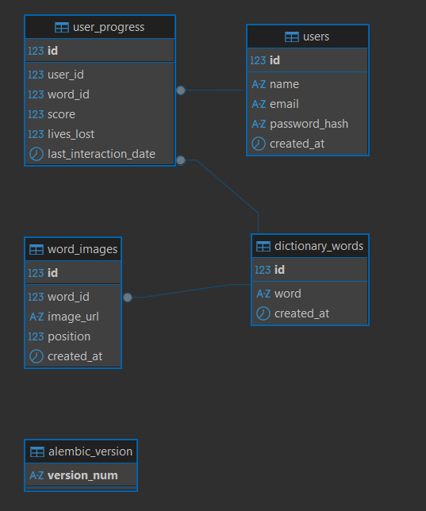

# Documentação do Banco de Dados

Documentação do schema PostgreSQL e controle de migrations via Alembic para o LibrasQuest.

---

## Diagrama do Schema



## Estrutura do Schema

O script SQL (`db_schema.sql`) define o schema `learning` com quatro entidades principais:

* **users**: Armazena as credenciais e dados de identificação dos usuários.
* **dictionary_words**: Guarda as palavras-alvo do dicionário.
* **word_images**: Armazena as imagens de dica associadas a cada palavra. Possui relacionamento N:1 com `dictionary_words` — uma palavra pode ter ilimitadas imagens. O campo `position` controla a ordem de exibição.
* **user_progress**: Registra a interação do usuário com cada palavra, computando pontuação e vidas perdidas. Utiliza uma chave composta (UNIQUE) para garantir que cada usuário tenha apenas um registro de progresso por palavra.

### Estrutura de arquivos (Alembic)

```
backend/
├── alembic/
│   ├── versions/        # arquivos de migration gerados
│   ├── env.py           # configuração do ambiente Alembic
│   └── script.py.mako   # template para geração de migrations
├── alembic.ini          # configuração principal
└── app/
    └── models.py        # modelos SQLAlchemy (fonte de verdade do schema)
```

> `models.py` é a fonte de verdade do schema — toda alteração no banco deve partir dali.

---

## Como Executar Localmente com Docker

O projeto utiliza `docker-composer.yml` na raiz do repositório. As migrations são aplicadas automaticamente via Alembic ao subir o container do backend.

1. Configure as variáveis de ambiente copiando o arquivo de exemplo:
   ```bash
   cp .env.example .env
   ```
   Preencha o `.env` com as credenciais.

2. Suba o banco de dados e o backend:
   ```bash
   docker compose -f docker-composer.yml up -d postgres backend
   ```

3. As migrations rodam automaticamente. Para verificar os logs:
   ```bash
   docker logs backend_librasquest
   ```

Para derrubar os containers:
```bash
docker compose -f docker-composer.yml down
```

---

## Migrations com Alembic

Ao subir o container, o `entrypoint.sh` executa `alembic upgrade head` automaticamente antes de iniciar o servidor. O Alembic aplica apenas as migrations pendentes com base na tabela `learning.alembic_version`.

### Pré-requisitos para uso local (fora do Docker)

```bash
# Na raiz do projeto
venv\Scripts\activate           # Windows
source venv/bin/activate        # Linux/macOS

pip install -r backend/requirements.txt
```

### Gerar uma nova migration

Sempre que alterar um model em `app/models.py`, gere uma migration:

```bash
# O banco precisa estar rodando
docker compose -f docker-composer.yml up -d postgres

cd backend

# Windows CMD
set DATABASE_URL=postgresql://<user>:<password>@localhost:5432/<db_name>

# PowerShell
$env:DATABASE_URL="postgresql://<user>:<password>@localhost:5432/<db_name>"

alembic revision --autogenerate -m "descricao_da_mudanca"
```

> Revise sempre o arquivo gerado em `alembic/versions/` antes de aplicar — o autogenerate pode incluir operações indesejadas.

### Aplicar migrations pendentes

```bash
alembic upgrade head
```

### Reverter a última migration

```bash
alembic downgrade -1
```

### Ver histórico de migrations

```bash
alembic history
```

### Ver versão atual do banco

```bash
alembic current
```

---

## Boas Práticas

- **Nunca edite** um arquivo de migration já aplicado — crie uma nova migration.
- **Sempre commite** os arquivos de `alembic/versions/` junto com as mudanças nos models.
- **Revise o autogenerate** antes de aplicar: ele pode não detectar corretamente renomeações de colunas ou tabelas.
- **Nunca commite o `.env`** com credenciais reais — use `.env.example` com valores placeholder.
- O Docker aplica as migrations automaticamente — não é necessário rodar manualmente em ambiente containerizado.

---

## Melhorias Propostas e Dúvidas

**Melhorias:**
* Implementar uma `TRIGGER` para atualizar automaticamente o momento da última interação.
* Criar um `INDEX` em colunas fundamentais (como o email) para otimização de consultas.

**Dúvidas e Pendências:**
* **Regra de Vidas:** Definir se haverá um limite superior estrutural para as vidas perdidas.